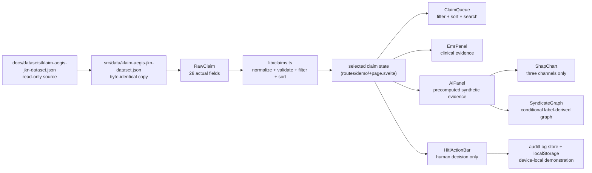

# Dashboard Architecture

## Data flow



## Folder structure

```text
dashboard/
├── src/
│   ├── components/
│   │   ├── ui/              # shadcn-style local primitives (Svelte 5 runes)
│   │   ├── demo/            # operational UI modules for the verifier demo
│   │   │   ├── ClaimQueue.svelte
│   │   │   ├── EmrPanel.svelte
│   │   │   ├── AiPanel.svelte
│   │   │   ├── ShapChart.svelte
│   │   │   ├── SyndicateGraph.svelte
│   │   │   ├── SyndicateNode.svelte
│   │   │   ├── HitlActionBar.svelte
│   │   │   ├── AuditLogPanel.svelte
│   │   │   └── RiskBadge.svelte
│   │   ├── CustomNode.svelte
│   │   └── FlowCanvas.svelte
│   ├── data/                # byte-identical synthetic source copy
│   ├── lib/claims.ts        # parsing, selection, filtering, sorting
│   ├── store/auditLog.ts    # client-side audit store (Svelte writable)
│   ├── types/claims.ts      # RawClaim and normalized Claim contracts
│   ├── routes/
│   │   ├── +layout.svelte   # global stylesheet + toaster
│   │   ├── +page.svelte     # public landing page
│   │   └── demo/+page.svelte# Dashboard Verifikator (demo)
│   ├── index.css            # Tailwind v4 entry + shadcn design tokens
│   ├── app.html
│   └── svelte.config.js
├── docs/
```

## Design decisions

### Source truth and normalization

The input schema is Indonesian and uses fields containing spaces. `RawClaim` preserves it exactly. `normalizeClaim()` creates an English component contract only in memory. It never writes calculated values back to the JSON.

`Skor Fraud`, `Status`, `Risiko`, `Sinyal SHAP`, and `Kontribusi Saluran` are data supplied by the synthetic file. The UI labels them as precomputed synthetic evidence. The application neither trains nor executes an MHGSL/XGBoost/rule engine.

### Explainability display

`Kontribusi Saluran` has a structured `T · F · S` format, so it becomes a three-bar visual with values and accessible table. The values do not necessarily sum to 1 and are not probabilities.

`Sinyal SHAP` is prose. It remains prose, split only on semicolons for readability. The dashboard deliberately does not fabricate signed per-feature SHAP bars.

### Syndicate graph

The actual dataset lacks an edge list. `SyndicateGraph` renders only if `Sindikat` exists and connects claims, patient labels, doctor labels, and facilities sharing that label. This is a transparent illustrative grouping, not discovered graph intelligence or a production network.

### Human-in-the-Loop boundary

All three actions open a note-required modal. A successful human action appends an `AuditLogEntry` containing only timestamp, claim ID, action, note, and source AI score. It does not change the claim, trigger payment control, approve/reject automatically, or call a remote system.

The audit log lives in `src/store/auditLog.ts` as a Svelte `writable` store that mirrors to `localStorage` under a key scoped by the source dataset hash. It is append-only within the device and is not immutable.

### Safe-Mode Fallback

The production concept requires freezing recommendations when verifier overrides exceed 30%. This static client-side app cannot compute a trustworthy rolling operational override rate, so it documents the policy but does not pretend to activate it.
