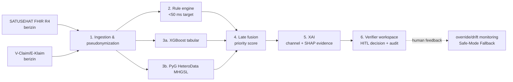
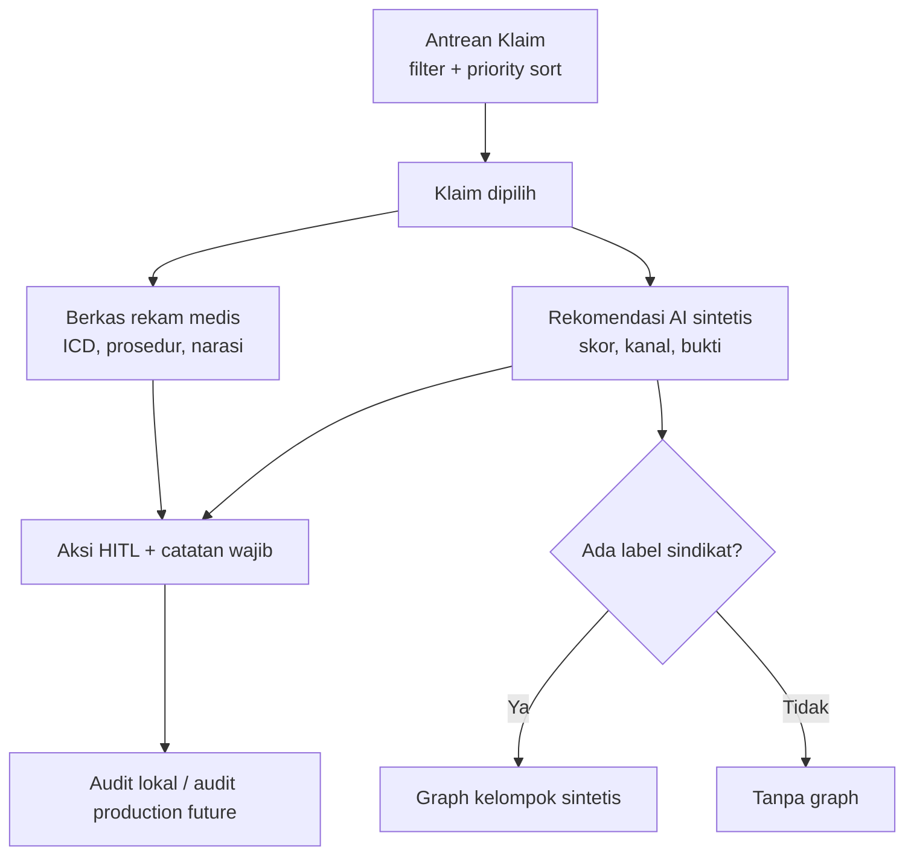

# Aegis-JKN: Clinical Decision Support System Deteksi Fraud Klaim JKN Berbasis Multi-Channel Heterogeneous Graph Structure Learning

## Abstrak

Program Jaminan Kesehatan Nasional (JKN) membutuhkan proses verifikasi klaim yang cepat, dapat dipertanggungjawabkan, dan sensitif terhadap pola kecurangan terstruktur. Tantangannya bukan hanya besarnya volume berkas, melainkan juga perbedaan antara anomali yang dapat ditemukan pada satu baris klaim dengan kolusi yang baru terlihat ketika pasien, dokter, fasilitas kesehatan, rujukan, diagnosis, dan prosedur dipandang sebagai jaringan. Makalah ini mengusulkan Aegis-JKN sebagai *clinical decision support system* (CDSS) untuk memprioritaskan telaah fraud klaim berbasis *Multi-Channel Heterogeneous Graph Structure Learning* (MHGSL). MHGSL menggabungkan tiga saluran representasi: topologi relasi operasional, kemiripan fitur klaim, serta semantik *metapath* klinis. Sistem diorganisasikan dalam arsitektur tri-tier: *rule engine* berlatensi rendah, baseline tabular XGBoost, dan *heterogeneous graph convolutional network* berbasis PyTorch Geometric, yang digabung melalui *late fusion*. Lapisan penjelasan menampilkan kontribusi saluran serta bukti SHAP agar rekomendasi dapat ditelaah oleh verifikator.

Purwarupa menggunakan dataset berisi 300 klaim sintetis yang tervalidasi secara internal sebagai simulasi skenario, bukan data peserta JKN riil. Seluruh hasil kinerja yang dibahas—akurasi 93,0%, presisi 94,12%, ROC-AUC 0,9825, AUPRC 0,9142, resistensi kamuflase 89,4%, dan deteksi sembilan pola sindikat—harus dibaca sebagai **hasil simulasi sintetis**, bukan validasi eksternal maupun bukti kesiapan produksi. Aegis-JKN menempatkan manusia sebagai pengambil keputusan final: AI hanya menyajikan prioritas, skor, dan bukti. Dengan demikian, kontribusi utama makalah ialah formulasi MHGSL anti-*topological camouflage*, rancangan CDSS tri-tier yang dapat dijelaskan, dan tata kelola *human-in-the-loop* yang selaras dengan privasi serta interoperabilitas kesehatan Indonesia.

**Kata kunci—** JKN, fraud klaim, MHGSL, graph neural network, SHAP, CDSS, human-in-the-loop, SATUSEHAT.

# 1. Pendahuluan

## 1.1 Latar belakang

JKN adalah infrastruktur jaminan sosial kesehatan berskala nasional. Narasi proyek Aegis-JKN menggunakan estimasi lebih dari 270 juta jiwa cakupan, lebih dari dua juta klaim per hari, serta sekitar seribu verifikator. Angka-angka ini dipakai sebagai konteks masalah dan perlu diverifikasi kembali terhadap publikasi operasional BPJS terbaru sebelum digunakan sebagai statistik resmi. Bila rasio tersebut dipakai sebagai ilustrasi, satu verifikator berhadapan dengan sekitar dua ribu klaim per hari—jauh di atas kapasitas telaah mendalam manusia yang lazimnya puluhan berkas per hari. Karena itu, masalah inti bukan memilih apakah otomasi atau manusia yang dipakai, tetapi merancang otomasi yang memperbaiki urutan prioritas tanpa merampas kewenangan profesional.

Fraud dalam klaim kesehatan memiliki banyak bentuk. *Upcoding* memanipulasi tingkat keparahan atau kode agar tarif meningkat. *Phantom billing* menagih pelayanan yang tidak diberikan. *Unbundling* memecah layanan paket menjadi komponen yang ditagihkan sendiri. Kolusi dokter–faskes dapat membentuk *fraud ring* dengan pola yang tidak kasatmata pada sebuah berkas. Pendekatan tabel konvensional dapat mendeteksi biaya ekstrem, lama rawat tidak wajar, atau ketidakcocokan diagnosis–prosedur. Namun, pendekatan tersebut menganggap record relatif independen dan sering gagal ketika pelaku sengaja merancang alur rujukan, variasi nominal kecil, atau pergantian identitas agar tiap klaim tampak wajar.

Aegis-JKN menyebut gejala terakhir sebagai **Topological Camouflage**. Pelaku dapat menciptakan rujukan yang tampak mengikuti pelayanan berjenjang, mengubah diagnosis minor antarberkas, atau menyebarkan tindakan pada entitas berbeda. Ketika hanya melihat satu baris, sinyalnya lemah. Ketika melihat pola pasien–dokter–faskes–prosedur dan jalur rujukan, kepadatan komunitas serta kemiripan lintas klaim dapat menjadi indikasi investigasi. Indikasi tersebut tetap bukan vonis fraud; ia adalah alasan untuk membaca bukti lebih dalam.

## 1.2 Gap penelitian dan masalah

XGBoost efektif sebagai baseline data tabular karena dapat memodelkan relasi nonlinier serta *missing values*. Akan tetapi, ia tidak memiliki mekanisme bawaan untuk *message passing* antarentitas. GNN memberi representasi relasional, tetapi graf tunggal juga dapat rapuh ketika hanya satu jenis hubungan yang dimanipulasi. MHGSL menawarkan tiga pandangan yang saling melengkapi: relasi nyata/topologi, kedekatan atribut, dan kesesuaian semantik melalui *metapath*. Literatur MHGSL kesehatan yang dirujuk [3] memberi dasar konseptual, tetapi penerapannya pada tata kelola JKN memerlukan pembatasan etis, FHIR, dan model kerja verifikator.

Kesenjangan berikutnya adalah penjelasan. Skor risiko tanpa alasan meningkatkan *alert fatigue* dan risiko tuduhan keliru. CDSS perlu menyajikan bukti terverifikasi: perbedaan diagnosis–prosedur, pola biaya/LOS, kontribusi kanal, dan relasi kelompok. Penjelasan tidak boleh diterjemahkan menjadi otoritas AI untuk menghentikan pembayaran otomatis.

## 1.3 Kontribusi

Makalah ini menyumbang empat hal. Pertama, formulasi MHGSL tiga saluran untuk menghadapi *topological camouflage*. Kedua, rancangan tri-tier yang mempertahankan jalur cepat dan menempatkan GNN pada telaah risiko tinggi. Ketiga, desain penjelasan gabungan kontribusi kanal dan SHAP yang ditujukan bagi verifikator. Keempat, rancangan HITL yang menegaskan keputusan akhir manusia, audit tindakan, dan *Safe-Mode Fallback* apabila override verifikator melewati 30%.

## 1.4 Sistematika

Bagian 2 membahas literatur. Bagian 3 merumuskan metode. Bagian 4 menjelaskan desain sistem. Bagian 5 mendeskripsikan eksperimen sintetis. Bagian 6 mendiskusikan makna dan batasan. Bagian 7 membahas HITL dan kepatuhan. Bagian 8 menyimpulkan pekerjaan.

# 2. Tinjauan Pustaka

## 2.1 Deteksi fraud asuransi kesehatan

Fraud kesehatan bersifat heterogen, imbalanced, dan sering hanya memperoleh label setelah audit. Herland *et al.* [12] membahas identifikasi Medicare provider fraud, sedangkan Johnson dan Khoshgoftaar [13] menunjukkan pemanfaatan jaringan saraf pada fraud Medicare. Tinjauan Nabrawi dan Alanazi [14] memperlihatkan penggunaan metode pembelajaran mesin untuk data klaim. Bukti ini mendukung penggunaan baseline tabular, tetapi tidak menghapus kebutuhan kalibrasi prevalensi, pengujian temporal, dan evaluasi *group-aware*.

Dalam konteks JKN, kode diagnosis, prosedur, obat, lama rawat, rujukan, dan narasi klinis merupakan bukti yang heterogen. Sebuah skor yang tinggi hanya relevan bila auditor dapat memeriksa kesesuaian sumbernya. Oleh sebab itu, definisi fraud untuk model harus dibedakan dari keputusan administrasi atau klinis; model mengestimasi prioritas telaah, bukan kesalahan legal.

## 2.2 Tabular, graf, dan MHGSL

Model tabular memetakan vektor fitur $x_i$ sebuah klaim menjadi skor $\hat y_i$. Kelemahannya adalah entitas yang sama muncul pada beberapa record tetapi relasinya diabaikan. Graf heterogen membentuk $G=(V,E,\tau,\phi)$, dengan tipe simpul $\tau:V\to\mathcal{A}$ dan tipe sisi $\phi:E\to\mathcal{R}$. Pada Aegis-JKN, $\mathcal{A}$ dapat mencakup Claim, Patient, Practitioner, Organization, Diagnosis, Procedure, dan Referral. Walaupun metadata sumber purwarupa belum menyediakan ID produksi maupun edge list, definisi ini adalah target arsitektur untuk data berizin.

GraphSAINT [2] relevan karena pembelajaran graf besar memerlukan sampling subgraf yang menjaga efisiensi. Paper MHGSL [3] mengusulkan pembelajaran struktur graf heterogen multi-saluran untuk fraud asuransi kesehatan. Posisi Aegis-JKN bukan mengklaim replikasi eksperimen paper itu, melainkan menerjemahkan prinsip tiga saluran ke rancangan CDSS JKN dan mendokumentasikan pembatasan validasi.

## 2.3 Explainable AI di layanan kesehatan

Lundberg dan Lee [1] memformalkan SHAP sebagai kerangka aditif berbasis nilai Shapley. Secara praktis, SHAP membantu menjawab fitur mana yang berkontribusi terhadap suatu prediksi. Namun, atribusi statistik bukan hubungan sebab-akibat dan tidak menggantikan penalaran klinis. Pada konteks graf, penjelasan harus memperhatikan fitur, struktur, serta konteks channel. Aegis-JKN karena itu menampilkan $\phi_{top}$, $\phi_{feat}$, dan $\phi_{sem}$ sebagai bukti prioritas, kemudian mengembalikan pembacaan ke berkas medis.

## 2.4 CDSS dan Human-in-the-Loop

CDSS yang aman memperluas kemampuan telaah, bukan membangun mekanisme otomatis penolakan klaim. Kualitas interaksi bergantung pada transparansi, mekanisme koreksi, dan jejak audit. Konsep multi-agent CAMEL [10] serta OASIS [11] dapat relevan untuk simulasi skenario sosial/operasional, tetapi bukan bukti efektivitas fraud atau interoperabilitas kesehatan. Penggunaan komponen tersebut harus dipisahkan dari mesin keputusan klaim.

Pada proses klaim, keputusan yang tampak sederhana dapat mempunyai akibat finansial, klinis, dan legal. Permintaan konfirmasi dapat mengubah kelancaran pelayanan fasilitas, sedangkan penolakan dapat memicu sengketa atau perbaikan dokumen. Karena itu, antarmuka tidak cukup hanya menampilkan probabilitas. Ia harus mendukung pembacaan dokumen sumber, mencatat rasionalisasi, dan membedakan rekomendasi sistem dari status keputusan verifikator. Literatur XAI menekankan bahwa interpretabilitas harus dihubungkan dengan tugas pengguna; daftar fitur penting tanpa konteks episode pelayanan sering kali tidak dapat ditindaklanjuti.

Dalam rancangan ini, manusia bukan tombol persetujuan terakhir dari keputusan yang telah dibuat mesin. Manusia adalah pengambil keputusan utama yang memakai sistem sebagai instrumen prioritisasi. Konsekuensi desainnya meliputi tiga hal. Pertama, setiap aksi memiliki catatan wajib. Kedua, tidak ada pembaruan otomatis terhadap status sumber klaim akibat skor. Ketiga, perbedaan antara rekomendasi dan keputusan aktual dipantau sebagai sinyal audit kualitas model, bukan sebagai kesalahan pengguna.

## 2.5 Interoperabilitas, provenance, dan kualitas data

FHIR tidak menjamin kualitas data hanya karena data memakai resource yang benar. Claim dapat secara sintaktis valid tetapi tidak lengkap; Procedure dapat ada tanpa konteks Encounter; atau narasi dapat memuat informasi yang tidak konsisten dengan kode. Oleh sebab itu, ingestion produksi memerlukan pemeriksaan provenance: sistem asal, waktu ekstraksi, versi mapping, identitas organisasi, dan status dokumen. Provenance tersebut harus dipisahkan dari fitur prediksi bila ia menciptakan shortcut yang tidak adil, tetapi tetap disimpan untuk audit.

Kualitas data juga bersifat dinamis. Perubahan kode, praktik pencatatan, tarif, kontrak, atau alur rujukan dapat membuat distribusi yang dulu normal menjadi tidak normal, atau sebaliknya. Drift bukan sekadar penurunan metrik; ia dapat mengubah arti suatu bukti bagi verifikator. Karena itu, arsitektur Aegis-JKN memisahkan monitoring data, monitoring skor, dan monitoring outcome audit. Ketiganya memerlukan definisi waktu, pemilik, dan tindakan respons yang terdokumentasi.

# 3. Metodologi

## 3.1 Formulasi masalah

Untuk setiap klaim $c_i$, sistem memprediksi skor prioritas $p_i\in[0,1]$ dan kumpulan bukti $e_i$. Output bukan keputusan pembayaran. Secara konseptual:

$$p_i = \sigma\left(\alpha r_i + \beta t_i + \gamma g_i\right), \qquad \alpha+\beta+\gamma=1,$$

ketika $r_i$ adalah skor aturan, $t_i$ adalah skor tabular, dan $g_i$ adalah skor graf. Bobot dikalibrasi pada data validasi yang dipisahkan secara ketat. Tindakan administratif $a_i$ hanya boleh ditetapkan verifikator berdasarkan $p_i$, bukti, dan kebijakan.

Dataset purwarupa memiliki 300 record sintetis dengan 28 field. Ia memuat `Skor Fraud`, `Status`, `Risiko`, `Sinyal SHAP`, dan `Kontribusi Saluran` yang telah diprakomputasi. Karena label itu sudah tersedia, implementasi frontend hanya menormalisasi dan menampilkan data; ia tidak melatih ulang maupun menghitung hasil MHGSL.

## 3.2 Graf heterogen dan tiga saluran

Graf topologi menggunakan adjacency observasional:

$$A_{top}^{(r)}[u,v]=\mathbb{1}\{(u,v,r)\in E\},$$

untuk relasi $r$ seperti pasien–klaim, dokter–klaim, faskes–klaim, atau rujukan–kunjungan. Saluran ini rentan terhadap kamuflase bila alur rujukan direkayasa, sehingga tidak berdiri sendiri.

Saluran fitur membangun kedekatan berdasar vektor yang telah dibersihkan $z_i$:

$$A_{feat}[i,j]=\mathbb{1}\left\{\frac{z_i^\top z_j}{\|z_i\|_2\|z_j\|_2}\geq\theta_{feat}\right\}.$$

Contoh fitur mencakup biaya ternormalisasi, LOS, frekuensi episode, kategori diagnosis/prosedur, dan pola obat. Fitur turunan skor atau label fraud harus diblokir dari fitur training untuk mencegah *score leakage*.

Saluran semantik mengukur kesamaan melalui metapath $\mathcal{P}$, misalnya Claim–Diagnosis–Procedure–Claim atau Patient–Doctor–Facility–Claim. Salah satu bentuk PathSim adalah:

$$A_{sem}^{\mathcal{P}}(i,j)=\frac{2\,|\{p:i\xrightarrow{\mathcal{P}}j\}|}{|\{p:i\xrightarrow{\mathcal{P}}i\}|+|\{p:j\xrightarrow{\mathcal{P}}j\}|}.$$

Tiga matriks tidak harus identik ukurannya pada implementasi heterogen; operator relasi atau proyeksi tipe dipakai untuk menyatukan pesan yang kompatibel.

## 3.3 Encoder kanal dan late fusion

Untuk channel $k\in\{top,feat,sem\}$, encoder GCN abstrak dapat ditulis:

$$H_k^{(l+1)}=\rho\left(\widetilde D_k^{-1/2}\widetilde A_k\widetilde D_k^{-1/2}H_k^{(l)}W_k^{(l)}\right),$$

dengan self-loop pada $\widetilde A_k$, matriks bobot channel-spesifik $W_k$, dan aktivasi $\rho$. Penyelarasan lintas channel dapat memakai parameter bersama atau regularisasi konsistensi. Embedding akhir digabung:

$$h_i=\operatorname{Fuse}(h_{i,top},h_{i,feat},h_{i,sem}),\qquad g_i=\sigma(w^\top h_i+b).$$

*Late fusion* tri-tier kemudian menggabungkan output rule, XGBoost, dan GNN. Rule engine menjaga prediksi eksplisit dan cepat; XGBoost menangani fitur tabular; GNN memperluas konteks relasional untuk kasus yang masuk antrean. Sistem produksi wajib memiliki batas waktu, fallback, serta observabilitas atas distribusi skor.

## 3.4 Penjelasan dan protokol anti-leakage

Atribusi kanal dapat dinyatakan sebagai $\Phi_i=(\phi_{top},\phi_{feat},\phi_{sem})$. SHAP per fitur disediakan bila struktur hasil mendukung nilai numerik. Pada file sintetis aktual, `Sinyal SHAP` hanya prosa; dashboard tidak mengubahnya menjadi batang signed palsu. Sebaliknya, tiga kontribusi saluran `T`, `F`, dan `S` ditampilkan apa adanya dan bukti naratif dipecah hanya untuk keterbacaan.

Anti-leakage memerlukan pemisahan group menurut pasien, faskes, atau dokter serta split temporal bila tersedia. `Skor Fraud`, label `Risiko`, status triase, dan penjelasan SHAP tidak boleh menjadi input model. Dataset aktual tidak memiliki ID grouping mandiri atau artefak `edges_v2.1`, sehingga tidak layak untuk mengklaim evaluasi MHGSL yang benar. Kondisi itu merupakan batasan, bukan detail yang boleh disembunyikan.

## 3.5 Desain eksperimen yang dapat direproduksi

Evaluasi produksi tidak boleh memakai random split record biasa bila pasien, dokter, atau fasilitas yang sama dapat muncul pada train dan test. Kebocoran semacam ini membuat model seolah mengenali pola baru padahal hanya mengingat entitas yang sudah pernah dilihat. Unit split harus dipilih menurut pertanyaan: GroupKFold per pasien untuk menguji generalisasi pasien, per faskes untuk menguji transfer organisasi, atau split temporal untuk menguji perubahan masa depan. Kombinasi split dapat memberi batas bawah yang lebih konservatif tetapi lebih jujur.

Protokol perlu menetapkan *data dictionary*, query ekstraksi, aturan deduplikasi, mapping kode, feature registry, seed, hyperparameter, dan versi artefak. Validasi internal perlu diikuti *temporal holdout*; validasi eksternal hanya boleh memakai institusi/perioda yang dasar aksesnya sah. Threshold operasi tidak dipilih dari akurasi global. Ia ditentukan melalui kapasitas antrean, target precision minimum, biaya false positive, dan proses eskalasi manusia. Kalibrasi, misalnya Platt scaling atau isotonic regression, harus dipelajari pada fold yang terpisah dari test akhir.

Untuk setiap baseline, laporkan interval kepercayaan bootstrap atau metode yang sesuai, confusion matrix pada threshold operasi, ROC-AUC, AUPRC, recall pada batas kerja, dan beban case review. Perbandingan tidak berhenti pada rata-rata. Model juga perlu diuji pada subkelompok yang secara hukum dan etis boleh dievaluasi, serta terhadap skenario data hilang, perubahan kode, dan rerouting rujukan. Semua protokol tersebut adalah rancangan evaluasi masa depan; purwarupa data sintetis tidak menyediakan dasar untuk menjalankannya secara valid.

## 3.6 Kriteria keselamatan model

Kriteria keselamatan Aegis-JKN mencakup: tidak ada tindakan otomatis; tidak ada rekomendasi tanpa bukti yang dapat dibuka; tidak ada data sumber yang dimutasi UI; dan tidak ada klaim generalisasi dari simulasi ke populasi JKN. Kegagalan parser bukti harus menghasilkan tampilan raw evidence atau status data tidak tersedia, bukan angka hasil tebak. Kegagalan graf harus menurunkan fungsi ke tampilan klaim tabular, bukan menghambat pembacaan EMR. Kegagalan audit lokal harus terlihat oleh pengguna, bukan disembunyikan.

# 4. Desain Sistem

## 4.1 Enam modul

Aegis-JKN dirancang sebagai enam modul: (1) ingestion SATUSEHAT/FHIR dan V-Claim yang hanya dapat diaktifkan melalui otorisasi, (2) rule pre-filter, (3) tri-tier scoring engine, (4) late fusion dan prioritisasi, (5) XAI layer, dan (6) antarmuka verifikator. Purwarupa dashboard yang disertakan hanya mengimplementasikan bagian keenam terhadap JSON lokal sintetis.



## 4.2 Kontrak data dan batas purwarupa

Sumber kanonik purwarupa adalah array JSON 300 record dengan 28 field. Field tersebut mempertahankan nama asli berbahasa Indonesia, termasuk `Biaya Rp`, `LOS hari`, `Skor Fraud`, `Kontribusi Saluran`, `Sinyal SHAP`, dan `Kontradiksi Narasi`. Lapisan normalisasi hanya hidup di memori browser: nilai `Sindikat` atau `Modus` kosong menjadi absent value, prosedur `—` menjadi prosedur tidak tersedia, dan tiga kontribusi channel diparse defensif dari format `T … · F … · S …`. Parser tidak menganggap nilai channel sebagai probabilitas karena jumlahnya pada sumber tidak selalu satu.

Klaim, status risiko, alasan, serta narasi pada purwarupa adalah data sintetis dan diprakomputasi. Tidak ada API, backend, training, inference, graph database, maupun konektor SATUSEHAT/V-Claim. Tidak ada tarif INA-CBG pembanding dan tidak ada delta yang sah untuk divisualisasikan. Pemberian nomor ID atau node relation pada dashboard dibatasi pada informasi sumber atau representasi label sintetis yang telah diberi penanda eksplisit.

## 4.3 Antarmuka verifikator

Ruang kerja memadukan antrean di kiri dan split view di kanan. Antrean menawarkan pencarian, filter risiko, kontradiksi, dan sindikat; default urut berdasarkan skor prioritas. Panel EMR memperlihatkan identitas pseudonim, diagnosis, prosedur, biaya sumber, obat, rujukan, dan narasi. Panel AI menampilkan skor, status rekomendasi, kanal, alasan, serta graph sindikat hanya jika label sumber ada. Dataset tidak memuat tarif INA-CBG pembanding, sehingga UI tidak mengarang delta biaya.



Wireframe operasional:

```text
Navbar: status verifikator | total antrean | fraud flag | selesai
┌─────────────Antrean────────────┬───────Berkas EMR───────┬────AI evidence────┐
│ filter / pencarian / table      │ ICD, prosedur, narasi  │ skor, T/F/S, SHAP │
│ KLM001 …                       │ biaya sumber, rujukan  │ graph bila sindikat│
├─────────────────────────────────┴────────────────────────┴───────────────────┤
│ [Setujui] [Minta Konfirmasi RS] [Tolak] + catatan wajib + disclaimer HITL   │
└──────────────────────────────────────────────────────────────────────────────┘
```

## 4.4 Keamanan aplikasi dan operasi target

SPA saat ini sengaja tidak memiliki autentikasi karena tidak memproses data nyata. Pada deployment internal yang memproses data berizin, pembatasan jaringan saja tidak cukup. Akses harus memakai SSO, MFA sesuai kebijakan organisasi, RBAC dengan least privilege, session timeout, serta audit access log. Keputusan perlu disimpan pada layanan append-only yang dikendalikan institusi, bukan hanya browser. Role verifikator, supervisor, auditor, dan administrator perlu dipisah agar tidak satu orang dapat mengubah konfigurasi model dan mengesahkan keputusan tanpa pengawasan.

Konfigurasi model, threshold, daftar aturan, dan versi mapping harus direkam bersama keputusan agar investigasi dapat merekonstruksi konteks. Rahasia tidak boleh ditempatkan di bundle frontend. Koneksi antarservice harus terenkripsi, data tersimpan dienkripsi, dan akses data mentah harus dibatasi menurut tujuan. Penilaian keamanan meliputi dependency review, pengujian otorisasi, logging yang tidak membocorkan data, prosedur backup/pemulihan, serta *incident response* yang melibatkan petugas perlindungan data.

## 4.5 Pengalaman pengguna dan aksesibilitas

Prioritisasi tidak boleh hanya bergantung pada warna. Badge risiko memiliki label teks, ikon atau konteks eksplisit, dan nilai skor. Tabel harus mendukung fokus keyboard, urut kolom, dan pencarian. Grafik channel menyediakan tabel nilai agar pembaca pembaca layar maupun pengguna cetak dapat memahami data. Modal keputusan menahan submit ketika catatan kosong. Peringatan sintetis dan disclaimer HITL ditempatkan permanen agar konteks tidak hilang saat verifikator berpindah record.

Kepadatan informasi perlu seimbang dengan keterbacaan. Bukti sumber ditempatkan dekat keputusan, bukan tersebar sebagai dashboard KPI yang dekoratif. Narasi tidak dipaksa menjadi numerik; jika bukti SHAP hanya prosa, prosa ditampilkan sebagai prosa. Prinsip ini mencegah *precision theater*: tampilan yang terlihat ilmiah tetapi membuat tingkat kepastian yang tidak dimiliki data.

# 5. Eksperimen dan Hasil

## 5.1 Setup simulasi sintetis

Semua hasil di bagian ini adalah **simulasi sintetis**. Dataset kanonik berisi 300 klaim, bukan data peserta riil. Distribusi aktual adalah 240 `low`, 10 `medium`, 14 `high`, dan 36 `fraud`; status terdiri dari 240 `auto_clear`, 24 `review`, dan 36 `escalate`. Dua belas record memiliki flag kontradiksi narasi. Sebanyak 36 record memiliki label `SYND-01` sampai `SYND-09`. Nilai total klaim sintetis adalah Rp3.526.650.000.

File ini tidak memiliki split training/test, identifier grouping independen, edge list, atau metadata seed. Oleh sebab itu, ia tidak mendukung pengulangan eksperimen MHGSL yang sah. Tabel kinerja berikut merekam angka konteks yang diberikan untuk presentasi konsep dan harus selalu dibaca sebagai hasil simulasi sintetis, bukan hasil rerun dashboard.

| Metode | Akurasi | Presisi | ROC-AUC | AUPRC | Status bukti |
|---|---:|---:|---:|---:|---|
| Baseline XGBoost | Tidak ditetapkan sebagai angka final | Tidak ditetapkan | Pembanding | Pembanding | Simulasi sintetis / baseline konseptual |
| Aegis-JKN MHGSL tri-channel | 93,0% | 94,12% | 0,9825 | 0,9142 | **Simulasi sintetis** |

Tidak ada kesimpulan statistik yang boleh ditarik dari tabel tersebut tanpa protokol group-aware, data berizin, dan replikasi yang terdokumentasi.

## 5.2 Validasi data dan kontrak visualisasi

Sebelum visualisasi, file sumber diverifikasi melalui checksum SHA-256 `2b8c4113da2dd742075282865b9075eb14061a8eea81a2f3da0035cbbae79d9a`; salinan dashboard harus byte-identik. Kontrak test juga memeriksa jumlah 300 record dan 28 field pada record pertama, normalisasi prosedur `—`, parser channel, fallback bukti SHAP, filter kontradiksi, filter sindikat, dan pengurutan prioritas. Ini membuktikan integritas artefak frontend terhadap source file yang diaudit; ini bukan validasi ilmiah terhadap akurasi model.

Validasi visualisasi menguji dua kondisi penting. Pertama, claim tanpa label sindikat tidak menampilkan graf. Kedua, sinyal SHAP `tidak ada sinyal dominan` tidak dipaksa menjadi chart angka. Kedua kondisi mengurangi risiko membuat bukti seolah lebih lengkap daripada yang tercantum pada sumber. Uji manual juga perlu memastikan tiga aksi HITL tidak dapat disimpan tanpa catatan dan bahwa status source claim tidak berubah setelah keputusan dicatat.

## 5.3 Analisis sindikat

Dataset menandai sembilan kelompok `SYND-01`–`SYND-09`. Kelompok ini mencakup skenario upcoding, phantom billing, unbundling, drug diversion, cloning, dan pola lain yang dirancang untuk demonstrasi. Pernyataan “deteksi 100% sembilan pola sindikat” adalah **hasil simulasi sintetis**. Ia bukan bukti bahwa seluruh fraud nyata dapat dideteksi, bukan bukti sensitivitas terhadap populasi nasional, dan bukan dasar auto-adjudication.

| Kelompok | Peran demonstrasi | Bukti yang ditampilkan |
|---|---|---|
| SYND-01 | Upcoding | Ketidakselarasan diagnosis–PCI, pola biaya/LOS dan grouping. |
| SYND-02 | Phantom billing | Layanan/prosedur yang dipertanyakan oleh bukti naratif/kelompok. |
| SYND-03 | Unbundling | Komponen layanan berulang dalam episode terkait. |
| SYND-04 | Drug diversion | Pola obat dan frekuensi sebagai bahan telaah. |
| SYND-05–09 | Variasi kolusi/anomali | Bukti record dan label kelompok sintetis. |

Graf dashboard tidak membuktikan adanya komunitas baru. Ia hanya menghubungkan klaim yang telah diberi label sindikat sama oleh data simulasi, sehingga pengguna tidak keliru menganggap visual sebagai hasil penemuan produksi.

## 5.4 Benchmark dan pembanding

XGBoost tetap baseline praktis karena cepat, kuat pada tabel, dan mudah dibandingkan. Namun, AUPRC lebih informatif daripada akurasi pada fraud jarang. Pada pengujian masa depan, pembanding perlu mencakup rule-only, XGBoost, GNN satu channel, fusion tanpa semantik, dan MHGSL penuh. Penilaian harus melaporkan *precision-recall curve*, sensitivitas pada beban antrean, false positive, waktu inferensi, serta kualitas penjelasan.

Angka “resistensi kamuflase 89,4%” dan proyeksi pemangkasan waktu review 30–50% adalah **simulasi sintetis/proyeksi desain**, bukan pengukuran lapangan. Uji kegunaan dengan verifikator, *time-and-motion study*, dan evaluasi keselamatan harus dilakukan sebelum angka dampak dipublikasikan sebagai temuan.

## 5.5 Protokol analisis kesalahan

Kesalahan paling mahal dalam CDSS fraud bukan selalu salah klasifikasi statistik. False positive dapat menambah beban rumah sakit dan verifikator, menunda penyelesaian klaim, atau menciptakan stigma. False negative dapat membiarkan pola penting tidak masuk antrean. Analisis pasca-audit perlu mengelompokkan kesalahan berdasarkan tipe modus, jenis layanan, ketersediaan narasi, jalur rujukan, dan usia data. Kategori tersebut digunakan untuk memperbaiki data dan aturan, bukan untuk mengekstrak atribut sensitif yang tidak diperlukan.

Setiap perubahan model harus dibandingkan dengan model aktif pada set holdout yang sama. Jika model baru meningkatkan ROC-AUC tetapi menurunkan precision pada kapasitas antrean yang dapat ditangani, perubahan belum tentu layak dipromosikan. Demikian pula, penjelasan yang semakin rinci tetapi tidak membantu verifikator mengambil tindakan dapat meningkatkan beban kognitif. Penilaian harus menyertakan waktu telaah, tingkat override, alasan override, dan kualitas dokumentasi keputusan.

## 5.6 Evaluasi human factors dan beban kerja

Evaluasi teknis perlu dilengkapi evaluasi human factors. Dalam studi terkontrol, verifikator dapat menerima kasus yang sama dalam urutan berbeda, dengan dan tanpa panel penjelasan, sambil waktu telaah dan kualitas keputusan dicatat. Desain harus menghindari penilaian berbasis kecepatan semata; pembacaan lebih cepat tidak bermanfaat bila alasan keputusan memburuk atau case bernuansa terlewat. Metode think-aloud, wawancara pascasesi, dan review contoh override dapat mengungkap bukti mana yang benar-benar berguna.

Metrik proses dapat meliputi waktu menuju keputusan, jumlah dokumen yang dibuka, jumlah permintaan klarifikasi yang tepat, konsistensi antarverifikator, dan proporsi case yang perlu eskalasi. Metrik ini tidak boleh dipakai menghukum individu tanpa konteks case mix. Tujuannya adalah memperbaiki desain sistem dan alur kerja. Dalam pilot, pengguna harus dapat melaporkan rekomendasi yang membingungkan, data yang tampak keliru, atau alasan mengapa AI tidak diikuti. Umpan balik tersebut harus disimpan sebagai evidence governance, bukan otomatis dijadikan label pelatihan.

Beban kognitif perlu dibatasi melalui progressive disclosure. Antrean cukup memperlihatkan identitas pseudonim, fasilitas, biaya sumber, skor, dan badge yang eksplisit. Detail narasi serta grafik dibuka untuk case yang dipilih. Pola ini mendukung scanning tanpa menyembunyikan bukti. Aksesibilitas juga bagian dari keselamatan: tindakan dapat dilakukan keyboard, fokus modal jelas, dan teks status tidak bergantung pada perbedaan warna. Pengujian dengan pembaca layar serta resolusi layar operasional perlu direncanakan sebelum produksi.

## 5.7 Kriteria penerimaan pilot

Pilot tidak dinilai berhasil hanya karena aplikasi dapat dibuka. Kriteria penerimaan minimum meliputi integritas sumber data, proses otorisasi, kemampuan merekonstruksi keputusan, absence of auto-adjudication, dan hasil uji keamanan yang dapat diterima. Dari sisi model, perlu ada baseline yang terdokumentasi, estimasi ketidakpastian, dan bukti bahwa peningkatan pada metric offline tidak berasal dari leakage. Dari sisi workflow, verifikator harus dapat menolak rekomendasi tanpa hambatan dan menuliskan rasionalisasinya.

Kriteria keluar atau rollback juga diperlukan. Contohnya adalah peningkatan tajam override yang tidak terjelaskan, perubahan distribusi input besar, kegagalan provenance, keluhan sistematis tentang bukti yang menyesatkan, atau insiden perlindungan data. Ketika kriteria tersebut terjadi, operasi kembali ke jalur manual/rule yang telah disetujui sambil investigasi dilakukan. Mekanisme ini lebih aman daripada mempertahankan model demi mengejar continuity of automation.

# 6. Diskusi

## 6.1 Interpretasi

Kekuatan MHGSL bukan sekadar meningkatkan skor. Nilai utamanya adalah pluralitas bukti: sinyal topologi dapat menangkap komunitas yang padat, fitur dapat menangkap kemiripan biaya/LOS, dan semantik dapat memeriksa jalur diagnosis–prosedur. Jika pelaku menyamarkan satu perspektif, perspektif lain dapat meningkatkan prioritas. Pendekatan ini lebih sesuai dengan *topological camouflage* daripada satu threshold biaya.

Namun, korelasi relasional tidak identik dengan fraud. Faskes rujukan, dokter subspesialis, atau pola klinis tertentu dapat secara sah membentuk komunitas padat. Penjelasan harus karena itu menunjukkan bukti tetapi tidak memberi label bersalah. Konfirmasi manusia, kebijakan pembayaran, dan mekanisme sengketa tetap berperan.

## 6.2 Keterbatasan

Keterbatasan terbesar adalah data. Dataset Aegis-JKN bersifat sintetis, kecil untuk evaluasi model, dan mengandung output turunan yang tidak boleh dipakai sebagai input. Tidak terdapat entity IDs mandiri, edge list, metadata generator, ataupun split group-aware. Nama display bersifat pseudonymized, tetapi tetap tidak boleh diperkaya atau dikirim ke layanan eksternal. Narasi dan indikator pendukung tidak menggantikan catatan medis asli.

Keterbatasan kedua adalah *ground truth*. Label fraud sintetis biasanya bersih dan lengkap, sementara dunia nyata memiliki audit tertunda, perubahan kebijakan, dan sengketa. Keterbatasan ketiga adalah fairness: perbedaan fasilitas, wilayah, case mix, maupun akses dapat menghasilkan pola yang tampak anomali. Audit bias perlu memeriksa false positive lintas strata yang disetujui dan sesuai hukum.

Keterbatasan keempat adalah antarmuka. Dashboard memuat audit pada `localStorage` sebagai demonstrasi. Penyimpanan browser dapat dihapus atau diubah pengguna dan tidak memenuhi jejak audit institusional. Ia sengaja diberi penanda agar tidak disalahartikan sebagai kontrol produksi.

## 6.3 Rencana benchmark

Tahap berikutnya adalah benchmark publik yang lisensinya ditelaah, misalnya dataset Healthcare Provider Fraud Detection di Kaggle, lalu data pilot berizin. Penyelarasan skema harus dipisahkan dari evaluasi. Dataset publik tidak dapat dianggap setara dengan JKN hanya karena sama-sama klaim kesehatan. Model perlu diuji dengan *GroupKFold* atau *Leave-One-Group-Out*, split temporal, ablation channel, dan pengulangan beberapa seed. Data pilot memerlukan dasar pemrosesan yang sah, minimisasi data, lingkungan on-premise, dan keterlibatan klinis.

## 6.4 Dampak potensial

Jika—dan hanya jika—hasil pilot yang ketat mendukungnya, CDSS dapat memotong waktu pencarian berkas dengan memusatkan perhatian ke bukti yang relevan. Estimasi pemangkasan review 30–50% adalah **proyeksi simulasi**, bukan janji layanan. Nilai yang lebih aman untuk diklaim sekarang ialah: sistem menyediakan urutan kerja, bukti yang dapat dibaca, dan ruang untuk mengukur keputusan manusia secara akuntabel.

## 6.5 Risiko implementasi dan mitigasi

Risiko teknis pertama adalah data drift. Mitigasinya ialah baseline distribusi, pemantauan perubahan feature dan score, review periodik, serta fallback manual. Risiko kedua adalah feedback loop: keputusan verifikator dapat dipengaruhi rekomendasi, lalu dipakai lagi sebagai label yang tampak objektif. Mitigasinya ialah memisahkan outcome audit, alasan keputusan, dan label training; melakukan sampling blind review; serta mendokumentasikan kapan rekomendasi terlihat oleh verifikator.

Risiko ketiga adalah *automation bias*. Verifikator dapat terlalu mempercayai skor tinggi atau mengabaikan sinyal rendah. Antarmuka mengurangi hal ini dengan menampilkan bukti, catatan wajib, dan disclaimer keputusan manusia. Risiko keempat adalah penggandaan penggunaan: skor fraud yang dibuat untuk prioritisasi dapat dicoba dipakai untuk sanksi, profiling, atau penetapan pembayaran. Tata kelola perlu membatasi tujuan penggunaan melalui kebijakan, kontrol akses, dan pengujian perubahan.

Risiko kelima adalah ketergantungan terhadap visual graf. Relasi yang terlihat rapat dapat terasa meyakinkan walaupun berasal dari label atau data yang tidak lengkap. Karena itu, graf sindikat purwarupa diberi disclaimer sebagai representasi kelompok dataset sintetis. Pada sistem produksi, setiap edge harus dapat ditelusuri ke sumber, waktu, tipe relasi, dan aturan pembentukannya.

## 6.6 Trade-off arsitektur dan biaya operasional

Arsitektur tri-tier sengaja tidak menjalankan GNN pada seluruh klaim sebagai satu-satunya jalur. Rule engine memberi respons yang dapat ditelusuri untuk pemeriksaan sederhana, misalnya kelengkapan administratif atau kombinasi kode yang memerlukan klarifikasi. Model tabular menyediakan pembanding yang murah dan stabil. MHGSL diletakkan pada jalur risiko atau batch investigasi ketika nilai konteks relasional melebihi biaya komputasi dan kompleksitas tata kelolanya. Pemisahan ini membuat organisasi dapat memulai dari baseline yang dapat diaudit sambil mengumpulkan bukti apakah graf memang menambah manfaat.

Pemilihan arsitektur juga memengaruhi kualitas operasi. Graph inference membutuhkan materialisasi relasi, kontrol konsistensi waktu, dan pencegahan *cross-case contamination*. Jika model memperoleh edge dari data yang tercatat setelah waktu keputusan claim, evaluasi dapat bocor ke masa depan. Sistem produksi perlu memberi timestamp pada node dan edge, membangun snapshot pada *cut-off* yang jelas, serta memastikan feature store dan graph store memakai definisi episode yang sama. Tanpa disiplin ini, performa offline dapat tampak tinggi tetapi gagal direplikasi saat operasi.

Skalabilitas tidak hanya berarti throughput GPU. Biaya terbesar dapat berupa kurasi data, resolusi identitas, validasi mapping, audit akses, dan telaah false positive. Karena itu, business case perlu mengukur jumlah case yang benar-benar dapat ditindak, waktu yang dihemat per bukti yang ditemukan, serta dampak kualitas pelayanan. Model yang sedikit lebih akurat tetapi menghasilkan bukti yang sulit dipahami mungkin lebih buruk daripada baseline yang transparan. Prinsip ini mendukung pengembangan bertahap, evaluasi ablation, dan keputusan investasi berbasis bukti.

## 6.7 Reproducibility dan transparansi ilmiah

Reproducibility memerlukan lebih dari repositori kode. Setiap hasil harus menyatakan asal data, periode, kriteria inklusi/eksklusi, preprocessing, definisi label, split, seed, versi dependency, serta konfigurasi hardware bila relevan. Artefak training tidak boleh memuat identitas langsung. Dokumentasi harus membedakan apa yang dapat dibuka ke publik—misalnya skema sintetis dan pseudocode—dari artefak yang hanya dapat diaudit dalam lingkungan terkendali.

Untuk Aegis-JKN, transparansi juga berarti mengomunikasikan ketidakpastian. Nilai skor tanpa interval atau tanpa status bukti dapat dipersepsikan terlalu pasti. Dashboard harus menampilkan asal bukti, tanggal ketersediaan, dan indikator ketika data tidak lengkap. Model card perlu menjelaskan intended use, non-intended use, populasi evaluasi, performance caveat, known failure modes, serta kontak eskalasi. Data sheet perlu menjelaskan proses pembuatan data sintetis dan memastikan pembaca tidak menyamakannya dengan observasi klinis dunia nyata.

# 7. Human-in-the-Loop dan Kepatuhan

## 7.1 Prinsip keputusan manusia

Larangan utama Aegis-JKN adalah veto otomatis. AI tidak boleh menyetujui, menolak, menghentikan, mengubah tarif, atau mengeskalasi klaim tanpa tindakan verifikator. Tiga tombol dashboard—Setujui Klaim, Minta Konfirmasi RS, dan Tolak—selalu membuka dialog catatan wajib. Entri log menyimpan timestamp, claim ID, aksi, catatan, serta skor AI saat keputusan. Skor dipertahankan sebagai konteks, bukan dasar tunggal.

*Safe-Mode Fallback* dirancang untuk membekukan rekomendasi baru apabila override verifikator lebih dari 30% dalam jendela operasi yang telah ditetapkan. Ambang ini adalah kebijakan desain dan perlu dikalibrasi bersama pemilik proses. Pada SPA statis, mekanisme tersebut belum diaktifkan karena tidak ada telemetry aman maupun denominator operasional yang sah.

## 7.2 UU PDP dan tata kelola

UU No. 27 Tahun 2022 menggolongkan data kesehatan sebagai data pribadi spesifik [6]. Konsekuensinya mencakup dasar pemrosesan, pembatasan tujuan, minimisasi, keamanan, manajemen insiden, dan akuntabilitas. UU Kesehatan No. 17 Tahun 2023 [7] serta Permenkes Rekam Medis No. 24 Tahun 2022 [8] menjadi konteks tata kelola kesehatan. Permenkes No. 16 Tahun 2019 [9] relevan terhadap pencegahan dan penanganan fraud JKN.

Pseudonymization bukan anonimisasi mutlak. Lingkungan produksi perlu tokenisasi/rotasi kunci, enkripsi saat transit dan tersimpan, kontrol akses berbasis peran, logging akses, retensi minimal, pemisahan tugas, dan prosedur tanggap insiden. Data klaim mentah tidak boleh dibundel dalam aset publik atau dikirim ke LLM cloud tanpa dasar hukum, penilaian risiko, serta kontrol yang disetujui.

## 7.3 FHIR R4 dan SATUSEHAT

HL7 FHIR R4 [4] menyediakan struktur interoperabilitas untuk Patient, Practitioner, Organization, Encounter, Condition, Procedure, MedicationRequest, MedicationDispense, dan Claim. SATUSEHAT menyediakan dokumentasi integrasi nasional [5]. Dalam arsitektur target, ingestion hanya mengambil elemen minimum yang dibutuhkan setelah otorisasi. Field naratif seperti Composition/resume harus dibatasi, diproteksi, dan dibuktikan asalnya. Purwarupa ini tidak memanggil SATUSEHAT atau V-Claim dan tidak boleh dipresentasikan seolah telah terintegrasi.

## 7.4 Retensi, akses, dan auditabilitas

Retensi log keputusan harus ditetapkan oleh kebijakan institusi dan ketentuan yang berlaku, bukan oleh default browser. Log produksi minimal memuat aktor yang terautentikasi, waktu, versi model/rule, versi data mapping, identitas klaim bertoken, aksi, alasan, dan referensi bukti. Perubahan log harus append-only dengan akses baca yang dibatasi; kebutuhan koreksi ditangani dengan entri koreksi baru, bukan penghapusan diam-diam. Penggunaan audit trail untuk pemantauan kinerja model perlu meminimalkan data yang dibawa ke laporan.

Hak akses mengikuti kebutuhan tugas. Verifikator membaca case yang ditugaskan; supervisor dapat meninjau sampel dan eskalasi; auditor dapat memeriksa log; administrator tidak otomatis memperoleh akses isi rekam medis. Pemisahan ini mengurangi risiko insider dan memudahkan investigasi. Semua ekspor harus dicatat, dibatasi formatnya, dan tunduk pada persetujuan atau dasar pemrosesan yang berlaku.

## 7.5 Akuntabilitas dan jalur keberatan

Setiap rekomendasi harus dapat dijelaskan pada level yang proporsional: bukti apa yang tersedia, dari mana datangnya, dan apa batasnya. Verifikator membutuhkan jalur untuk menandai data salah, bukti kurang, atau rekomendasi tidak relevan. Fasilitas kesehatan juga membutuhkan prosedur administratif untuk menanggapi permintaan klarifikasi sesuai kebijakan yang berlaku. Model tidak boleh memutus keberatan tersebut; ia hanya dapat membantu menyusun konteks bagi manusia yang berwenang.

Governance board yang melibatkan pemilik proses, ahli klinis, keamanan informasi, perlindungan data, legal, dan perwakilan audit perlu menyetujui perubahan bermakna. Persetujuan mencakup perubahan feature, threshold, tujuan penggunaan, sumber data, serta integrasi baru. Dokumentasi model card dan data sheet sebaiknya diperbarui bersamaan dengan rilis sehingga batas klaim sistem tidak hilang setelah purwarupa berkembang.

# 8. Kesimpulan dan Pekerjaan Lanjutan

Aegis-JKN mengusulkan CDSS fraud klaim JKN yang menggabungkan rule engine, baseline tabular, dan MHGSL tiga saluran. Pendekatan ini dirancang untuk menghadapi pola kolusi yang lolos dari analisis satu baris, sekaligus menjaga keterjelasan melalui kontribusi channel dan bukti SHAP. Nilai operasionalnya terletak pada prioritisasi dan penjelasan, bukan dalam pemberian putusan otomatis.

Makalah ini juga menetapkan batas yang tegas: seluruh metrik kinerja yang disebut adalah **simulasi sintetis**, dataset aktual belum memungkinkan validasi MHGSL group-aware, dan dashboard hanya merupakan visualisasi client-side atas bukti yang sudah tersedia. Pekerjaan lanjutan meliputi desain graf dari sumber berizin, leakage blocklist, split entitas/waktu, benchmark publik yang terdokumentasi, pilot dengan verifikator, evaluasi fairness dan usability, serta audit trail server-side yang aman. Sampai tahapan tersebut terpenuhi, keputusan final harus tetap berada pada verifikator manusia.

Roadmap implementasi sebaiknya dibagi menjadi empat tahap. Tahap pertama adalah penguatan kontrak data dan baseline rule/table tanpa mengambil data berlebih. Tahap kedua adalah pilot tertutup dengan audit manual dan pengukuran workflow. Tahap ketiga adalah evaluasi MHGSL dengan graph provenance yang memadai serta ablation terukur. Tahap keempat adalah operasi bertahap dengan governance change control, monitoring drift, review independen, dan opsi rollback. Tidak satu pun tahap mengubah prinsip bahwa skor AI tidak memiliki hak veto.

Keberhasilan Aegis-JKN pada akhirnya tidak ditentukan oleh kompleksitas graf atau besarnya skor AUC, melainkan oleh kemampuan organisasi mempertahankan proses verifikasi yang adil, dapat ditelusuri, dan bermanfaat bagi pelayanan kesehatan. Teknologi harus membantu manusia menemukan bukti yang relevan, bukan memindahkan tanggung jawab kepada model. Karena itu, setiap perluasan fungsi perlu dibuktikan melalui evaluasi yang transparan, dibatasi oleh tujuan pemrosesan yang sah, dan dapat dihentikan ketika bukti keselamatan tidak lagi memadai.

Secara praktis, backlog terdekat mencakup penyusunan kamus fitur dan data contract bersama pemilik proses, penetapan definisi fraud yang dapat diaudit, rancangan de-identification, dan uji integrasi read-only pada sandbox yang sah. Sesudah itu, tim dapat menguji baseline yang sederhana terhadap data berizin dan membandingkannya dengan workflow manual sebelum membangun graf heterogen penuh. Urutan ini menjaga biaya eksperimen, mencegah penguncian pada arsitektur yang terlalu dini, dan memberi bukti yang diperlukan untuk menentukan apakah MHGSL menambah nilai di luar baseline.

# 9. Referensi

[1] S. M. Lundberg and S.-I. Lee, “A unified approach to interpreting model predictions,” in *Advances in Neural Information Processing Systems 30*, 2017, pp. 4765–4774. doi: 10.48550/arXiv.1705.07874.

[2] H. Zeng, H. Zhou, A. Srivastava, R. Kannan, and V. K. Prasanna, “GraphSAINT: Graph sampling based inductive learning method,” in *International Conference on Learning Representations*, 2020. doi: 10.48550/arXiv.1907.04931.

[3] S. Hong, J. Kim, and H. Lee, “Health insurance fraud detection based on multi-channel heterogeneous graph structure learning,” *Heliyon*, vol. 10, no. 9, Art. no. e30045, 2024. doi: 10.1016/j.heliyon.2024.e30045. [CITATION NEEDED: verify author metadata and article number against publisher PDF before formal submission.]

[4] Health Level Seven International, “FHIR Release 4 (v4.0.1),” Oct. 2019. [Online]. Available: https://hl7.org/fhir/R4/

[5] Kementerian Kesehatan Republik Indonesia, “SATUSEHAT Platform: Dokumentasi teknis dan katalog REST API,” 2026. [Online]. Available: https://satusehat.kemkes.go.id/platform/docs/id/playbook/

[6] Republik Indonesia, *Undang-Undang Nomor 27 Tahun 2022 tentang Pelindungan Data Pribadi*, 2022. [Online]. Available: https://peraturan.bpk.go.id/Details/229798/uu-no-27-tahun-2022

[7] Republik Indonesia, *Undang-Undang Nomor 17 Tahun 2023 tentang Kesehatan*, 2023. [Online]. Available: https://peraturan.bpk.go.id/Details/258028/uu-no-17-tahun-2023

[8] Kementerian Kesehatan Republik Indonesia, *Peraturan Menteri Kesehatan Nomor 24 Tahun 2022 tentang Rekam Medis*, 2022. [Online]. Available: https://peraturan.bpk.go.id/Details/245544/permenkes-no-24-tahun-2022

[9] Kementerian Kesehatan Republik Indonesia, *Peraturan Menteri Kesehatan Nomor 16 Tahun 2019 tentang Pencegahan dan Penanganan Kecurangan (Fraud) serta Pengenaan Sanksi Administratif terhadap Kecurangan (Fraud) dalam Pelaksanaan Program Jaminan Kesehatan*, 2019. [CITATION NEEDED: complete Berita Negara metadata from official JDIH PDF.]

[10] G. Li, H. A. A. K. Hammoud, H. Itani, D. Khizbullin, and B. Ghanem, “CAMEL: Communicative agents for ‘mind’ exploration of large language model society,” in *Advances in Neural Information Processing Systems 36*, 2023. doi: 10.48550/arXiv.2303.17760.

[11] Z. Yang *et al*., “OASIS: Open agent social interaction simulations with one million agents,” 2024. doi: 10.48550/arXiv.2411.11581.

[12] M. Herland, T. M. Khoshgoftaar, and R. A. Bauder, “Approaches for identifying U.S. Medicare fraud in provider claims data,” *Health Care Management Science*, vol. 21, pp. 247–259, 2018. doi: 10.1007/s10729-018-9460-8.

[13] J. M. Johnson and T. M. Khoshgoftaar, “Medicare fraud detection using neural networks,” *Journal of Big Data*, vol. 6, Art. no. 63, 2019. doi: 10.1186/s40537-019-0225-0.

[14] F. Nabrawi and A. Alanazi, “Fraud detection in healthcare insurance claims using machine learning,” *Risks*, vol. 11, no. 9, Art. no. 171, 2023. doi: 10.3390/risks11090160.
